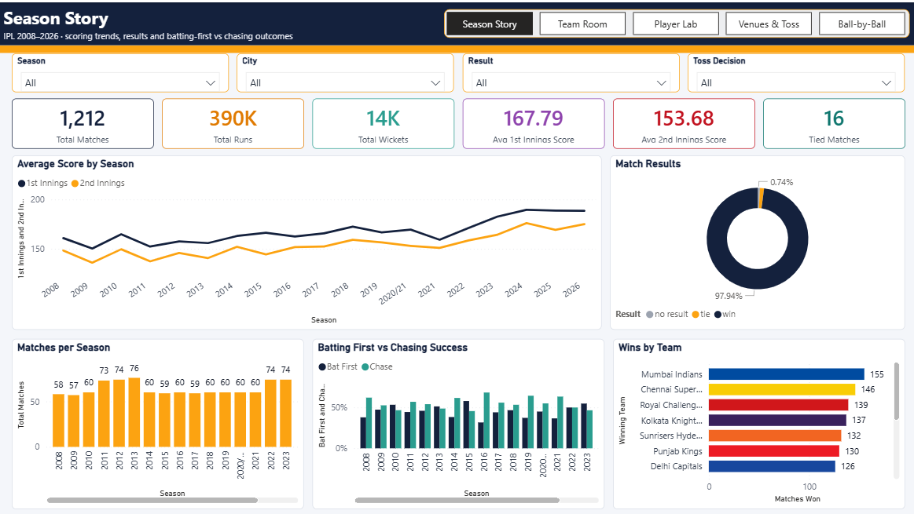
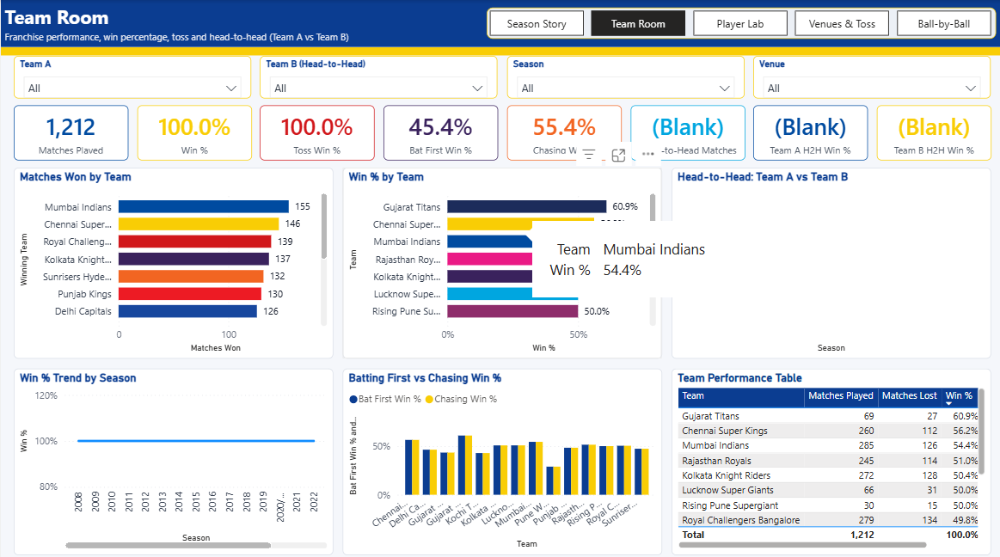
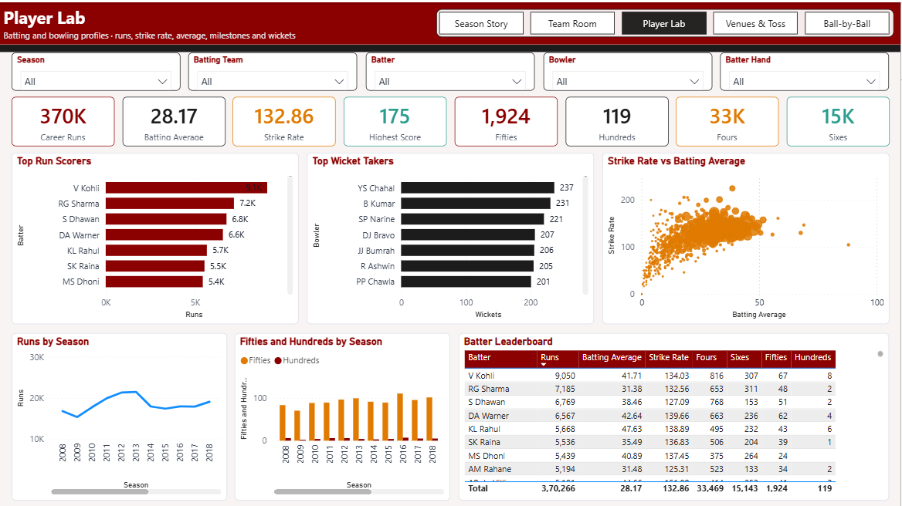
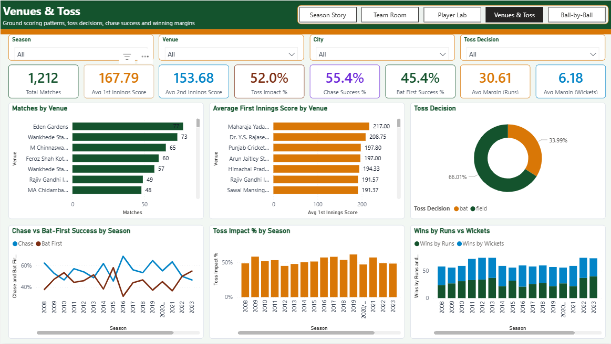
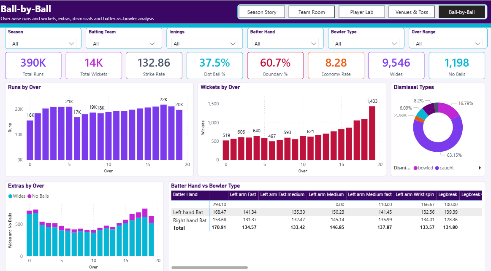

# IPL Analytics | Interactive Power BI Dashboard

## Project Overview
This project is an end-to-end business intelligence solution that analyzes Indian Premier League (IPL) cricket data from 2008 to 2026. Built using Microsoft Power BI, it transforms raw match and ball-by-ball delivery records into an interactive, dimensional semantic model. The dashboard delivers comprehensive insights into season trends, team performance, individual player statistics, venue dynamics, and granular ball-by-ball match information.

The project is saved in the modern Power BI Project (`.pbip`) format, utilizing TMDL (Tabular Model Definition Language) and PBIR formats for clean, source-control-friendly versioning.

---

## 🌟 Project Highlights
* **Five Interactive Report Pages:** Dedicated views for Season Story, Team Room, Player Lab, Venues & Toss, and Ball-by-Ball analysis.
* **Granular Ball-by-Ball Analysis:** Deep dive into over-wise runs, wickets, extras, and specific batter-vs-bowler matchups.
* **Role-Playing Dimensions:** Advanced data modeling utilizing inactive relationships for versatile team and player analysis (e.g., batting team vs. bowling team, batter vs. bowler).
* **Portable Data Sources:** Uses a configurable Power Query parameter (`WorkspaceDataPath`) to allow seamless dataset loading across different local environments.
* **Developer-Friendly Format:** Fully tracks PBIP, TMDL, and PBIR metadata in GitHub instead of relying entirely on monolithic binary `.pbix` blobs.

---

## 📊 Dashboard Pages

| Page | Purpose | Key Analyses |
| :--- | :--- | :--- |
| **Season Story** | High-level summary of IPL history and scoring trends. | Matches played, total runs, average 1st/2nd innings scores, wins by team, and batting-first vs. chasing success rates. |
| **Team Room** | Franchise performance and head-to-head records. | Win percentages, toss win impact, head-to-head (Team A vs Team B) records, and overall team performance tables. |
| **Player Lab** | Individual batting and bowling profiles. | Career runs, batting average, strike rate, centuries/fifties, top run scorers, top wicket-takers, and strike rate vs. average scatter plots. |
| **Venues & Toss** | Ground scoring patterns and toss decision impacts. | Matches by venue, average first innings score per venue, toss decisions (bat vs. field), and win margins (runs vs. wickets). |
| **Ball-by-Ball** | Granular delivery-level and over-level insights. | Over-wise runs/wickets, economy rates, extras (wides/no-balls), dismissal types, and batter hand vs. bowler type analysis. |

---

## 📁 Dataset Overview
The project relies on a robust set of CSV datasets.

| Filename | Analytical Purpose | Key Fields |
| :--- | :--- | :--- |
| `ipl_matches_data.csv` | Match-level outcomes and metadata (**1,212 matches**) | `match_id`, `season`, `city`, `venue`, `toss_winner`, `toss_decision`, `match_winner`, `win_by_runs`, `win_by_wickets` |
| `ball_by_ball_data.csv` | Granular delivery details (**288,226 deliveries**) | `match_id`, `batter`, `bowler`, `over_number`, `batter_runs`, `extras`, `is_wicket`, `dismissal_kind` |
| `players-data-updated.csv` | Player metadata and roles (**799 players**) | `player_id`, `player_name`, `bat_style`, `bowl_style` |
| `teams_data.csv` | Franchise metadata (**16 teams**) | `team_id`, `team_name` |
| `team_aliases.csv` | Resolving historical team name changes | `team_id`, `alias_name` |

> **Note:** The datasets are sourced for educational and portfolio purposes. Please review original sources for official licensing or redistribution rights.

---

## 🛠️ Technology Stack
* **Microsoft Power BI Desktop:** For report authoring and data modeling.
* **DAX (Data Analysis Expressions):** For complex aggregations and custom measures.
* **Power Query (M):** For data transformation and configurable path parameters.
* **Power BI Project (PBIP):** Source-control friendly project structure.
* **TMDL & PBIR:** Text-based representations of the semantic model and report layouts.
* **Git & GitHub:** For version control and portfolio hosting.

---

## 🏗️ Data Model & Architecture
The semantic model follows a strictly structured Star Schema consisting of two fact tables and several dimension tables.

**Architecture Flow:**


**Key Modeling Decisions:**
* **Fact Tables:** `Fact Match` (match-level grain) and `Fact Ball` (delivery-level grain).
* **Role-Playing Dimensions:** The `Dim Team` and `Dim Player` tables utilize **inactive relationships** connected via `USERELATIONSHIP()` in DAX. This allows a single `Dim Team` table to filter for the `team1`, `team2`, `toss_winner`, `batting_team`, or `bowling_team` seamlessly.
* **Cross-Filtering:** `Fact Ball` filters through `Fact Match` to access higher-level dimensions like `Dim Venue` and `Dim Date`.

---

## 📈 Key Metrics & Analytical Capabilities
The model includes over 30 custom DAX measures categorized for analytical depth:

* **Team & Match Performance:** `Matches Played`, `Matches Won`, `Win %`, `Bat First Win %`, `Chasing Win %`, `Toss Impact %`
* **Batting Performance:** `Total Runs`, `Batting Average`, `Strike Rate`, `Boundary %`, `Batting Dot Ball %`, `Fifties`, `Hundreds`
* **Bowling Performance:** `Total Wickets`, `Economy Rate`, `Bowling Average`, `Bowling Dot Ball %`, `Balls per Wicket`
* **Head-to-Head (H2H):** Dedicated measures (`H2H Team A Wins`, `H2H Team B Win %`) calculating dynamically based on selected opponents in the Team Room page.

---

## 🗂️ Repository Structure

```text
.
├── .gitignore
├── data/                               # Required source CSV datasets
│   ├── ball_by_ball_data.csv
│   ├── ipl_matches_data.csv
│   └── ...
├── IPL_Analytics/
│   ├── IPL_Analytics.pbip              # Power BI Project entry point
│   ├── IPL_Analytics.pbix              # Compiled Power BI binary
│   ├── IPL_Analytics.Report/           # PBIR visual definitions
│   └── IPL_Analytics.SemanticModel/    # TMDL data model and parameters
└── README.md
```

---

## 🚀 Getting Started
To clone and run this project on your local machine:

**Prerequisites:**
* Install [Git](https://git-scm.com/)
* Install [Power BI Desktop](https://powerbi.microsoft.com/desktop/) (Ensure the **Power BI Project (.pbip) save option** preview feature is enabled if using an older version).

**Step-by-step Setup:**
1. **Clone the repository:**
   ```bash
   git clone https://github.com/tvlswamy27/ipl-analytics-powerbi.git
   ```
2. **Open the project:**
   Navigate to the `IPL_Analytics/` folder and double-click `IPL_Analytics.pbip` to open it in Power BI Desktop.
3. **Configure the Data Path:**
   * In Power BI Desktop, go to **Home** > **Transform data** > **Edit parameters**.
   * Update the `WorkspaceDataPath` parameter to point to the `data/` folder on your local machine (e.g., `C:\YourFolder\ipl-analytics-powerbi\data\`). Ensure the path ends with a backslash `\`.
4. **Refresh the Model:**
   * Click **Apply Changes** and then click **Refresh** on the Home ribbon to load the CSV data into the model.
   * Verify that the visuals load on all five report pages.
5. **Save:** Save your local changes if required.

---

## 📸 Dashboard Preview
**Season Story** - High-level summary of IPL history and scoring trends.


**Team Room** - Franchise performance and head-to-head records.


**Player Lab** - Individual batting and bowling profiles.


**Venues & Toss** - Ground scoring patterns and toss decision impacts.


**Ball-by-Ball** - Granular delivery-level and over-level insights.


---

## 🧠 Project Learnings
* **Configurable Data Environments:** Successfully replaced hardcoded absolute file paths with a dynamic Power Query `WorkspaceDataPath` parameter, allowing for seamless GitHub collaboration and portability.
* **Advanced DAX & Role-Playing Dimensions:** Implemented complex `USERELATIONSHIP()` calculations to handle scenarios where multiple columns in a fact table (like batting team vs. bowling team) needed to interact with a single dimension table.
* **PBIP & TMDL Workflows:** Transitioned from a monolithic `.pbix` workflow to a source-control-friendly `.pbip` architecture, isolating report layout (PBIR) from the semantic model (TMDL).

---

## 🔮 Future Enhancements
* Implement incremental refresh for the ball-by-ball fact table to optimize loading times.
* Integrate dynamic narrative visuals using DAX to automatically generate text-based match summaries.
* Incorporate Python or R visuals for advanced predictive analytics (e.g., expected score projections).

---

## 🔗 Author & Project Link
**Project Link:** [https://github.com/tvlswamy27/ipl-analytics-powerbi](https://github.com/tvlswamy27/ipl-analytics-powerbi)
